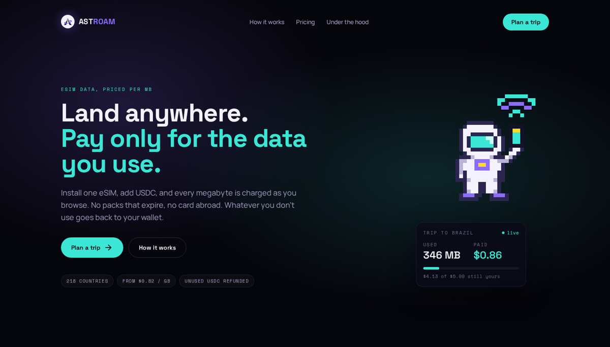
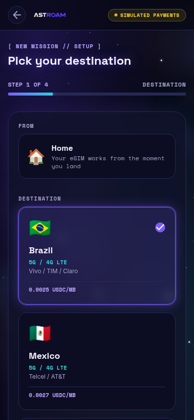
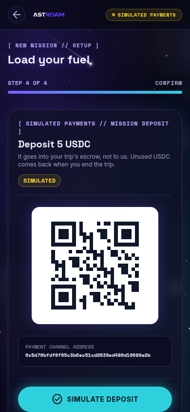
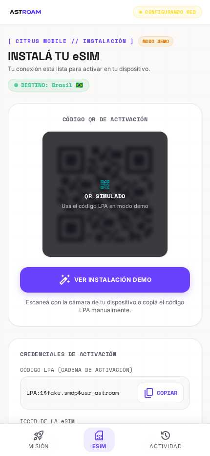
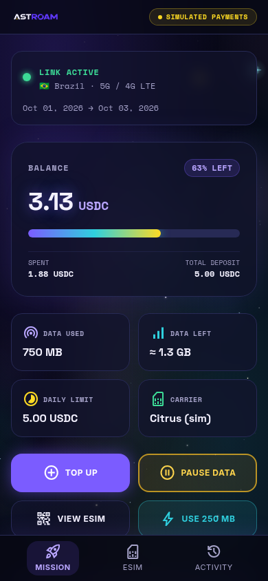
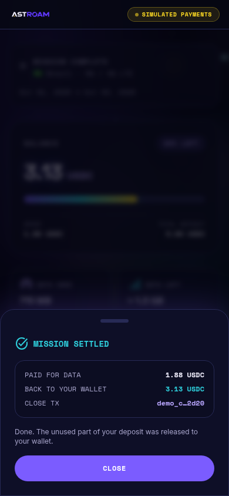
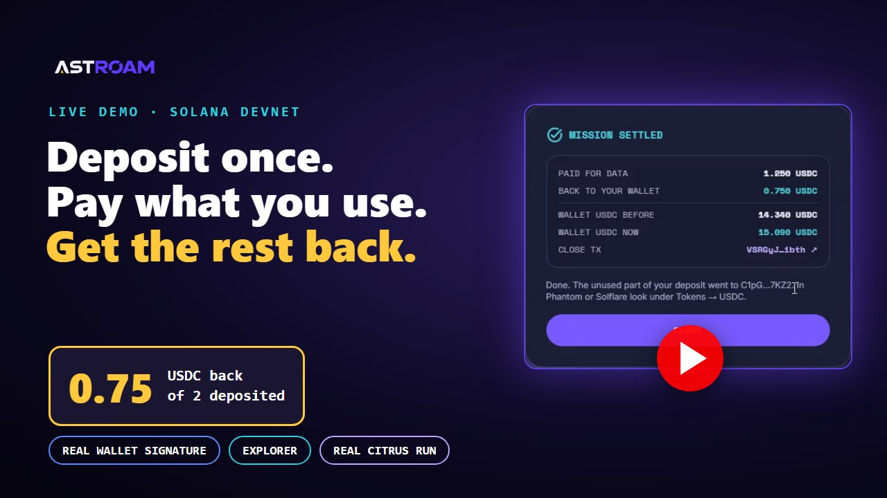
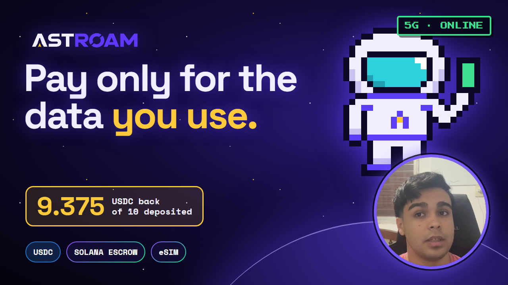
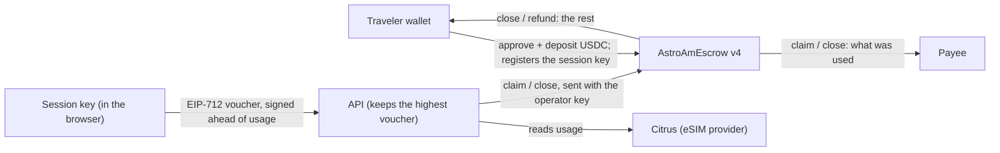

# AstroAm

**Mobile data in any country, paid per MB in USDC. Pay for what you use; get the rest back.**

The traveler deposits USDC into a payment channel on Monad and installs one eSIM. Usage is metered off chain. The traveler's app signs cumulative EIP-712 vouchers with a session key, ahead of usage: no transaction per megabyte. AstroAm collects what was used with the voucher as the ceiling. When the trip ends, one transaction pays AstroAm what was used and the channel returns the rest of the deposit to the traveler.

Built for **Monad Metropolis 2026** (track: Consumer Products & Payments) by
[@FrancoDuran23](https://github.com/FrancoDuran23), [@DanielPalermoo](https://github.com/DanielPalermoo),
[@ignaMartin22](https://github.com/ignaMartin22) and [@Joel010999](https://github.com/Joel010999).



<table>
  <tr>
    <td></td>
    <td></td>
    <td></td>
    <td></td>
    <td></td>
  </tr>
  <tr><td>Destination &amp; rate</td><td>Deposit</td><td>eSIM</td><td>Trip</td><td>Settled</td></tr>
</table>

These screenshots are of the app in demo mode (the badge reads "Simulated payments"): no wallet and no chain are involved in them.

## Status at a glance

| Part | State |
|---|---|
| Escrow contract `AstroAmEscrow` **v4** (operator separate from payee, `claim` bounded by usage) | **Deployed on Monad testnet** at [`0x89738331…987d`](https://testnet.monadvision.com/address/0x89738331BadF0cb4278c21DE4D282dC24EE2987d). |
| Escrow contract **v3** | **Deployed on Monad testnet** at [`0xe89893d5…c0f9`](https://testnet.monadvision.com/address/0xe89893d51180e517e2bf175398aad2e6da82c0f9), one end-to-end run on 2026-10-07. A previous version: replaced by v4. |
| Backend (mission API, metering, fund flow, `MonadRail` for v4) | **Working** and tested, including against a local chain and Monad testnet with v4 deployed. |
| Traveler app (React + Vite) | **Working.** Wallet flows (deposit, top-up, refund after the timeout) connected to Monad testnet. |
| Hosted demo (Vercel + Render) | **Deployed.** Frontend: [`astroam-monad.vercel.app`](https://astroam-monad.vercel.app), Backend: [`astroam-monad.onrender.com`](https://astroam-monad.onrender.com). |
| eSIM provider Citrus Mobile | **Integrated** behind `CONNECTIVITY_PROVIDER=citrus`. A real eSIM run was done with the Solana build only; none has settled on Monad. |
| Videos | Recorded on the Solana build. A Monad recording will replace them. |

Deploying v4 and the hosting are complete. Test numbers and the commit they are for: [Checks and test verification](#checks-and-test-verification).

## Live demo and deployment

> **Hosted demo:** Frontend at [`https://astroam-monad.vercel.app`](https://astroam-monad.vercel.app), API backend at [`https://astroam-monad.onrender.com`](https://astroam-monad.onrender.com). Steps and guide in [docs/deploy.md](docs/deploy.md).

What exists today:

- **Contract on Monad testnet (chain id 10143):** escrow v3, with its 2026-10-07 transactions, under [The deployed contract](#the-deployed-contract).
- **Testnet funds:** MON for gas at [faucet.monad.xyz](https://faucet.monad.xyz), testnet USDC at [faucet.circle.com](https://faucet.circle.com).
- **Test Verification Report:** [docs/test-verification.md](docs/test-verification.md) (373 backend, 61 contract and 36 frontend tests passing, as of commit `975035a`).
- **Run it yourself:** [Try it in 5 minutes](#try-it-in-5-minutes) needs no wallet; [Test with your own deploy](#test-with-your-own-deploy) is the wallet path on Monad testnet.

### Walkthrough for judges

Until the hosted demo exists, the flow can be seen in three ways:

1. **No wallet, five minutes:** the app in demo mode ([Try it in 5 minutes](#try-it-in-5-minutes)). Every payment there is simulated and labelled so.
2. **The one run on Monad testnet:** open the v3 deposit and close transactions under [The deployed contract](#the-deployed-contract): 5 USDC in, 0.625 USDC to the payee, 4.375 USDC back to the traveler, in the [full report](docs/monad-e2e-test-report.md).
3. **With a wallet, on your own deploy** of escrow v4 ([Test with your own deploy](#test-with-your-own-deploy)):
   1. Open the app with MetaMask (or another EVM wallet) on Monad testnet.
   2. Pick a destination (for example Brazil), travel dates and a budget (for example 5 USDC).
   3. Approve the USDC and confirm the deposit in the wallet. The app generates a session key in the browser for this trip.
   4. The trip page opens with a sample eSIM and traffic metering; the button that injects demo traffic is on while `ENABLE_DEMO_TRAFFIC=true`.
   5. Click **End mission**: the backend sends `close` with its operator key. AstroAm's payee receives what was used and the rest of the USDC returns to your wallet in the same transaction.

## Demo video

[](https://youtu.be/tX7weju0MBc)

Watch on YouTube: [youtu.be/tX7weju0MBc](https://youtu.be/tX7weju0MBc). The file is also in the Solana repository: [`AstroAm-demo-EN.mp4`](https://github.com/FrancoDuran23/astroam-solana/blob/main/docs/demo/AstroAm-demo-EN.mp4) (1:58, English subtitles burned in).

**This video was recorded on the Solana build. A Monad recording will replace it.** The script for the Monad recording is [docs/demo-video-script.md](docs/demo-video-script.md).

## Video pitch

[](https://youtu.be/q7B5czCrMdw)

Watch on YouTube: [youtu.be/q7B5czCrMdw](https://youtu.be/q7B5czCrMdw). The file is also in the Solana repository: [`AstroAm-pitch-EN.mp4`](https://github.com/FrancoDuran23/astroam-solana/blob/main/docs/demo/AstroAm-pitch-EN.mp4) (1:58, English subtitles burned in), rendered from [`docs/demo/promo`](https://github.com/FrancoDuran23/astroam-solana/tree/main/docs/demo/promo) there.

**This video was recorded on the Solana build. A Monad recording will replace it.**

## Problem

Roaming plans are sold in big blocks. A weekend trip still pays for a week or a pile of gigabytes, and the unused part expires. The bill shows up later.

## Solution

You pick a country and a USDC budget. Each country has its own per-MB rate, shown up front (Brazil: 0.0025 USDC/MB, so 5 USDC is about 2 GB). Two wallet transactions, an `approve` and a `deposit`, put Circle testnet USDC into the `AstroAmEscrow` contract on Monad, not into an account of ours. The deposit also registers a session key that the app generated in your browser. Usage is measured off chain. As you use data, the app signs EIP-712 vouchers with the session key for the running total it lets AstroAm charge, a little ahead of usage: no wallet popup per MB and nothing on chain per MB. One close pays AstroAm what was used and sends the remainder back. If nobody closes, after a timeout (30 days by default) you withdraw everything not yet collected with a button in the app.

The eSIM screen in this demo is a sample profile. No live carrier is connected to anything hosted. A real Citrus eSIM was issued from this flow in one controlled run by a team member on 2026-10-09 with the **Solana build** of the same backend, not a traveler on a trip; no run with a real eSIM has settled on Monad. See [Real eSIM](#real-esim) below and [docs/real-esim.md](docs/real-esim.md).

The contract, `contracts/src/AstroAmEscrow.sol`, does not debit per megabyte:

1. **deposit** — the traveler puts USDC in the escrow and registers the session key that signs vouchers for this escrow.
2. Usage is measured off chain. The app signs one cumulative voucher, `Voucher(bytes32 escrowId, uint256 cumulativeAmount)`, with the session key. A voucher is the most the traveler authorizes, not a bill, and it can never exceed the deposit.
3. **claim** — during the trip the operator collects the usage not yet paid, up to the voucher: `claim(escrowId, voucherAmount, signature, claimTotal)` pays the payee `claimTotal` minus what was already claimed and leaves the escrow open. Each claim restarts the timeout.
4. **close** — pays the payee what was actually used (never less than already claimed, never more than the voucher) and refunds the rest to the traveler, in one transaction.
5. **refund** — `timeoutSeconds` (30 days by default) after the last deposit, top-up or claim, returns everything not yet claimed to the traveler. Anyone can send it.
6. **topUp** — the same traveler adds USDC to the same escrow, before close.

Amounts are USDC with 6 decimals; the backend's internal unit is 1 raw = 1e-7 USDC and each rail converts.

## Why Monad

Each point below is something the code relies on.

1. **EVM tooling and EIP-712 typed signatures.** The voucher is an EIP-712 message that the contract checks with `ecrecover`, and viem signs it in the browser and recovers the signer on the server. A test pins the digest the contract computes against the TypeScript one. The contract is tested with Foundry, and the rail is tested against a local anvil node with the real contract deployed.
2. **A session key in the browser.** An EVM account is just a secp256k1 key. The app generates one per trip, the deposit registers its address in the contract, and from then on the browser signs vouchers silently. That is what removes the wallet popup per megabyte.
3. **Gas low enough to claim often, so little is ever owed off chain.** The fund flow sends a `claim` whenever the used and uncollected amount reaches `CLAIM_MIN_USDC` (2 USDC by default). That design only makes sense if a transaction costs far less than the amount it collects. This repository has not measured Monad's fee for a full session, so no figure is given here.
4. **Fast finality for deposit confirmation.** The backend confirms a deposit by reading the transaction receipt and the `Deposited` event from the escrow, and only then does the trip move on to the eSIM, which is provisioned on activation. The traveler waits on that step, so a short wait to confirmation matters. No timing is claimed here.
5. **Circle's USDC on the same chain.** The escrow pays and refunds in Circle's USDC on Monad testnet (`0x534b2f3A21130d7a60830c2Df862319e593943A3`, 6 decimals), and the constructor rejects a token that does not report 6 decimals.

## The deployed contract

> **PENDING: escrow v4 on Monad testnet.** The v4 address, and the table of transactions for a full run (approve, deposit, claim, close), will be added after the team deploys v4 and runs it end to end on Monad testnet. Until then the contract below is **v3, a previous version**, and the transactions are those of its 2026-10-07 run.

Network: **Monad testnet**, chain id `10143`. Circle USDC (6 decimals): `0x534b2f3A21130d7a60830c2Df862319e593943A3`.

**v3 (previous version, deployed)**

| | |
|---|---|
| Address | [`0xe89893d51180e517e2bf175398aad2e6da82c0f9`](https://testnet.monadvision.com/address/0xe89893d51180e517e2bf175398aad2e6da82c0f9) |
| Deploy transaction | [`0x5a8c225be99ac3bf4f35eb2c0356b9d76808e1750a9cd2db3113915017327a0b`](https://testnet.monadvision.com/tx/0x5a8c225be99ac3bf4f35eb2c0356b9d76808e1750a9cd2db3113915017327a0b) |
| Payee (also the account that sent `close`) | `0xE3E38BE1522E2086B135cb9e9b3D223708485316` |
| Refund timeout | 2,592,000 s (30 days) |

The 2026-10-07 run on v3, one trip to Brazil with demo traffic and a sample eSIM ([report](docs/monad-e2e-test-report.md)):

| Step | Transaction |
|---|---|
| Deposit, 5 USDC | [`0x9afbb1f1…f8275e0`](https://testnet.monadvision.com/tx/0x9afbb1f19e7a7ea3fb56cdf043b618605f562ef69531a823523334d22f8275e0) |
| Close: 0.625 USDC to the payee, 4.375 USDC back to the traveler | [`0xb8125f53…f5684f`](https://testnet.monadvision.com/tx/0xb8125f53a7ab622983f8e2e1ee65c3bc9ffe94ae5a9173abe096eafa44f5684f) |

That run had the traveler's wallet sign the approval and the deposit, and the payee account sign the close. No `claim` was sent. The 250 MB of traffic was injected by the demo button.

**v4 (current version, deployed)**

| | |
|---|---|
| Address | [`0x89738331BadF0cb4278c21DE4D282dC24EE2987d`](https://testnet.monadvision.com/address/0x89738331BadF0cb4278c21DE4D282dC24EE2987d) |
| Deploy transaction | [`0x69ec605d0242eb757248618454fee3b0335dddd958186de3e4cb4e29ff432ae0`](https://testnet.monadvision.com/tx/0x69ec605d0242eb757248618454fee3b0335dddd958186de3e4cb4e29ff432ae0) |
| Payee | `0xb8ec7Fe73740eeC5Bc3E85E414562AfCd8056b61` |
| Operator | `0xb8ec7Fe73740eeC5Bc3E85E414562AfCd8056b61` |
| Refund timeout | 2,592,000 s (30 days) |

Its calls:

| Call | Who | What |
|---|---|---|
| `deposit(escrowId, amount, signer)` | traveler | Locks USDC and registers the app's session key |
| `topUp(escrowId, amount)` | traveler | Adds USDC to the same escrow |
| `claim(escrowId, voucherAmount, signature, claimTotal)` | operator or payee | Pays the payee `claimTotal - claimed`; `claimTotal` is above what was claimed and not above the voucher; the escrow stays open |
| `close(escrowId, voucherAmount, signature, settleAmount)` | operator or payee | Pays the payee `settleAmount - claimed` (at least what was claimed, at most the voucher) and refunds the rest to the traveler |
| `refund(escrowId)` | anyone, after the timeout | Returns `deposit - claimed` to the traveler, once the timeout has passed since the last deposit, top-up or claim |
| `setOperator(address)` | payee | Replaces the operator without redeploying |

What changed from v3 and why is in [docs/monad-deployments.md](docs/monad-deployments.md), which is also the record of every deployed version (v1 to v4). Vouchers are signed against the contract address, so a v3 voucher is not valid on v4.

### Real eSIM

> **PENDING: real eSIM on Monad.** The run with a real Citrus eSIM on 2026-10-09 was done with the **Solana build** of the same backend. Its evidence is in astroam-solana: [docs/real-esim.md](https://github.com/FrancoDuran23/astroam-solana/blob/main/docs/real-esim.md#run-of-2026-10-09) and its [mission log](https://github.com/FrancoDuran23/astroam-solana/blob/main/docs/evidence/2026-10-09-real-esim-mission-log.txt). A run with a real eSIM that settles on Monad is still to be done by the team, after the v4 deploy. This repository's own page is [docs/real-esim.md](docs/real-esim.md).

## Prior work

This repository starts from AstroAm's base built for another hackathon
(Stellar), imported unchanged in the first commit
([`0ae9756`](https://github.com/FrancoDuran23/astroam-monad/commit/0ae9756)).
Everything after it is new work for Metropolis: Stellar was removed, payments
were moved behind a chain-agnostic `PaymentRail`, the Stellar-era frontend was
translated to English and moved to a dark space theme with a moving starfield,
and the Monad payment channel was added (`contracts/`, `src/rails/MonadRail.ts`,
`frontend/src/chain/monad.ts`).

## Architecture

```
traveler wallet (MetaMask Connect, on Monad testnet)
  -> approve + deposit USDC into AstroAmEscrow, registering a session key
browser (session key)
  -> signs the cumulative EIP-712 voucher, ahead of usage
backend (operator key, off chain)
  -> keeps the highest voucher, reads usage from the eSIM provider,
     sends claim / close
AstroAmEscrow (on chain)
  -> pays the payee what was used, refunds the rest to the traveler
```

```
src/
  rails/        PaymentRail port, FakeRail (in memory, follows the contract's rules) and MonadRail (viem)
  product/      mission API used by the app (/api/missions ...), channel locks, mission repository
  meter/        meter: asks for a voucher per reading, credits data only when signed
  services/     funding tranches, cutoff policy, session close, Citrus balance and webhooks
  providers/    eSIM providers: CitrusProvider (real) and FakeProvider (demo)
  jobs/         the fund-flow loop and usage reconciliation against the carrier
  persistence/  eSIM records and webhook log (JSON files)
  shared/       money math (BigInt), voucher schemas, preflight rules, retries, network ids
  server/       HTTP app: /health, /ready, /api, /citrus/webhooks
contracts/      AstroAmEscrow.sol + Foundry tests
scripts/        deploy-monad-escrow.ts, check-real-run.ts, close-escrow.ts, generate-abi.ts
frontend/       React + Vite + Tailwind; wallet + session-key vouchers in frontend/src/chain/monad.ts
```

`PaymentRail` (`src/rails/PaymentRail.ts`) is the only place that knows about a chain: create a deposit intent, confirm a deposit from the chain, read the channel, claim, close and refund. The eSIM provider is behind `CONNECTIVITY_PROVIDER`; the default is `fake` (a sample profile in memory), and `citrus` talks to the real reseller API.

The background is a Canvas 2D starfield (`frontend/src/components/StarfieldBackground.tsx`): three parallax layers of twinkling stars, a drifting band of cosmic dust and the odd shooting star. It pauses in hidden tabs and draws a still frame for reduced motion.

### Team & roles

Team of four, based in Jujuy, Argentina, working full-time remote (as stated in the astroam-solana README).

| Name | GitHub | Role | Main areas |
|---|---|---|---|
| Franco Agustín Durán (founder) | [@FrancoDuran23](https://github.com/FrancoDuran23) | Contract v4, payments backend and frontend | Escrow v4 and its rail, wallet flows and vouchers in the app |
| Ignacio Martín | [@ignaMartin22](https://github.com/ignaMartin22) | Escrow contracts and connectivity (eSIM) | Escrow `claim` and redeploys (v2), deploy scripts, Citrus integration |
| Daniel Palermo | [@DanielPalermoo](https://github.com/DanielPalermoo) | Backend and metering | The automatic fund flow: tranches, claims, automatic close; traveler interviews |
| Joel Santos | [@Joel010999](https://github.com/Joel010999) | Frontend | Traveler app, mobile, eSIM flow in the UI; owner of the real-trip sessions in the roadmap |

### Custody and key details

This is what `contracts/src/AstroAmEscrow.sol` v4 does. It is not deployed, so no v4 key exists yet.

**Where the USDC sits.** In the escrow contract's own balance of USDC, with one record per trip (`escrows[escrowId]`: traveler, session key, deposit, claimed, last activity, settled). The deposit credits the contract. It does not credit a team wallet.

**Who signs what.**

- `deposit` and `topUp`: the traveler's wallet.
- Vouchers: the session key in the traveler's browser (or the traveler's wallet), never the operator or the payee.
- `claim` and `close`: the **operator** (the server key) or the payee. Anyone else reverts with `NotOperator`.
- `refund`: anyone, after the timeout.
- `setOperator`: only the payee.

**Where a payout can go.** USDC leaves the contract only through three calls. `claim` and `close` pay the **payee**, which is fixed at deployment and cannot change; `close` and `refund` pay the **traveler**. The operator never receives USDC. No call lends, stakes or wraps the balance, and the contract has no upgrade authority: it is immutable.

**Keys.** The server holds one key, `MONAD_OPERATOR_PRIVATE_KEY`, which needs only testnet MON for gas. Who holds the v4 deployer, payee and operator keys will be known when the team deploys. The v3 payee, `0xE3E38BE1522E2086B135cb9e9b3D223708485316`, was also the account that sent `close`, so a stolen server key would have been stolen funds; v4 exists to remove that.

**Why this is not custody of traveler funds.** This describes the contract. It is not legal advice. While an escrow is open, the traveler's USDC is in the contract and the only places it can go are the payee, up to what the traveler signed, and the traveler. It is not lent and earns no yield. Whether a regulator would treat any part of this as custody of third-party funds is a legal question this README does not answer.

## Trust model



### Who holds what

| Holder | Holds | Can | Cannot |
|---|---|---|---|
| Traveler wallet | The traveler's USDC | Deposit, top up; send `refund` after the timeout | Be debited beyond what it approves and deposits |
| Session key, in the browser | Nothing of value by itself | Sign vouchers for its escrow, up to the deposit | Move funds. Only the operator or the payee can send `claim` or `close` |
| Operator key, on the server | Nothing: it never receives USDC | Send `claim` and `close` | Send funds anywhere but the payee and the traveler; claim above the highest voucher; change the payee |
| Payee | Everything collected | Receive every `claim` and `close` payment; replace the operator with `setOperator` | Be changed: it is fixed at deployment |

### What the contract enforces

- **The amount is bounded by a signed voucher.** A voucher is verified against the escrow's session key or its traveler. It binds the chain, the contract address and the escrow id, so it does not replay elsewhere, and it can never exceed the deposit.
- **Collected never exceeds the voucher.** `claimTotal` must be above what was already claimed and not above the voucher. `close` settles between what was claimed and the voucher.
- **Collected cannot be taken back.** `close` cannot settle below what was claimed.
- **The traveler can always get out.** If AstroAm never closes, `refund` returns everything unclaimed after the timeout, 30 days by default, counted from the last deposit, top-up or claim. A settled escrow cannot be used again.

### What a failure costs

- **A stolen operator key cannot take funds.** It can close channels early at the amount already claimed, which refunds the traveler and loses AstroAm the unclaimed usage; or have the payee paid up to a voucher the traveler signed; and it can delay a refund by claiming a voucher in small parts, because each claim restarts the timeout. The payee stops it by setting a new operator.
- **A traveler who stops signing** exposes AstroAm to one funding tranche (`FUNDING_TRANCHE_CENTS`, default $2.50): the backend funds the eSIM at most one tranche ahead of what the vouchers cover.
- **A stolen session key** cannot move funds. It can only raise the ceiling the operator may claim up to, never above the deposit. Clearing the browser loses it: the trip can then be settled only up to the last voucher, and the rest is refunded.
- **If AstroAm disappears,** the traveler withdraws everything unclaimed after the timeout (30 days by default) with a button in the app. **That button appears only in the browser that made the deposit**, because the escrow details are kept in that browser's local storage. From another browser or device the app has no button; anyone can still call `refund` on the contract directly.

### What is still trusted

- **AstroAm's usage metering, and the provider's figures.** The contract cannot know the usage. It enforces only that nobody is paid above the highest voucher. An honest backend claims `min(used, voucher)`; a dishonest operator could claim the whole voucher. What the traveler controls is how far ahead of usage the app signs, and that margin is all that is ever exposed.
- **Citrus reports usage in USD charged, not in bytes**, so megabytes are derived from the country rate ([why usage is metered by the provider](docs/decisions/metering-with-provider.md)).
- **The server holds the latest voucher until it is claimed.** With no database, a restart on a host without a disk loses it. Unclaimed usage is then lost to AstroAm, and the traveler gets the rest back.
- **No audit** of the contract or the backend.

### The plan, not done

The payee as a multisig: deploy v4 with a multisig as `MONAD_PAYEE_ADDRESS`, so no single key receives or controls the collected funds, and keep only the operator key on the server, rotated with `setOperator`. The payee is immutable, so this is chosen at deployment. It is not done.

## Try it in 5 minutes

You need Node 22.18 or newer. **No wallet and no chain are needed.**

Outside explicit demo mode the app never simulates a payment: with the backend on `PAYMENT_RAIL=fake` it shows "payments are not available". So the five-minute path is the frontend in demo mode, which runs entirely in the browser with no backend:

```bash
cd frontend
npm install
echo "VITE_ASTROAM_MODE=demo" > .env
npm run dev                                 # app on http://localhost:5173
```

Open the app, start a mission and press the simulated deposit. On the trip screen, **Use 250 MB** simulates a carrier reading (5 USDC in Brazil runs out after 8 of them). Every payment is labelled "Simulated payments". Remove `frontend/.env` to leave demo mode.

The wallet path needs `PAYMENT_RAIL=monad` and a deployed v4 escrow, so it needs your own deploy: see the next section. Without a deploy you can also run `npm test`, which starts a local chain, deploys v4 on it and exercises the rail end to end (it needs Foundry installed), and `npm run contracts:test`.

Publishing a public URL: [docs/deploy.md](docs/deploy.md).

## Test with your own deploy

Escrow v4 is not deployed on testnet, and the code has no path for v3, so using the wallet means deploying your own copy. On testnet that costs nothing and shares no secret.

1. Install Foundry: `curl -L https://foundry.paradigm.xyz | bash && foundryup`.
2. Get testnet MON for gas at [faucet.monad.xyz](https://faucet.monad.xyz) for the deployer and for the operator, and testnet USDC for the traveler wallet at [faucet.circle.com](https://faucet.circle.com). The traveler wallet uses MetaMask on Monad testnet, a different account from the deployer.
3. Choose three accounts: a deployer, a payee (where the USDC goes: a cold wallet or a multisig) and an operator (the server key). **The operator must differ from the payee.** For example, `cast wallet new` prints a fresh address and key.
4. Export the deploy variables in the shell. Do not write the deployer key into `.env`:

   ```bash
   export MONAD_DEPLOYER_PRIVATE_KEY=0x...    # pays gas for the deploy only
   export MONAD_PAYEE_ADDRESS=0x...           # receives every claim and close
   export MONAD_OPERATOR_ADDRESS=0x...        # the address of the server key
   # optional: export MONAD_TIMEOUT_SECONDS=2592000   # refund window, default 30 days
   ```

5. `npm run monad:deploy`. It runs `forge build`, checks the RPC's chain id, that the deployer has MON and that the USDC address has code and 6 decimals, refuses a payee equal to the operator (`--allow-same-key` permits it for local testing), deploys, reads `usdc()`, `payee()`, `operator()` and `timeoutSeconds()` back and fails on any mismatch, and prints the lines to paste into `.env` and an explorer link. It never prints a key. With `MONAD_ESCROW_ADDRESS` already set it does not deploy: it checks that contract against the environment (`--force` deploys a new one). With no environment it prints usage and exits without touching the network.
6. Copy the printed lines into your local `.env` (`PAYMENT_RAIL=monad`, `MONAD_ESCROW_ADDRESS=...`) and set `MONAD_OPERATOR_PRIVATE_KEY` to the operator's key. Do not paste an address the script did not print.
7. `npm run real:check`. Read-only: it sends no transaction, creates no eSIM and spends nothing. It prints one line per check (`ok`, `warn` or `FAIL`) in three groups and exits non-zero if any fails: the chain (RPC, chain id, the escrow's code and `usdc()`, that your key is the escrow's `operator()` or `payee()`, the operator's MON), the provider (Citrus key accepted, balance covers one eSIM plus one tranche, webhook secret set) and the configuration (`PAYMENT_RAIL=monad`, `ENABLE_DEMO_TRAFFIC=false`, and a `FRONTEND_ORIGIN` that is set, not a wildcard and, with `CONNECTIVITY_PROVIDER=citrus`, local: `localhost`, `127.0.0.1` or a private LAN address, because testnet funds are free and on a public app anyone could spend the reseller's real balance). It also prints a note about `ASTROAM_LIVE_ENABLED`: leave it `false`, since the app sends no access token. It is the preflight for a run with a real eSIM, so with the sample eSIM provider only the chain lines matter.
8. `npm run server`. The log should say `payment rail operator ready`, not `payment rail cannot collect or close`. `GET /ready` answers 503 with `operator_not_authorized` when the configured key is neither the contract's operator nor its payee, and the API then refuses to create payment intents, so the app shows "payments are not available". `GET /api/capabilities` should show `paymentsLive: true`.
9. In another shell: `cd frontend && npm install && npm run dev`. Leave `frontend/.env` out and Vite proxies `/api` to the backend on port 8080. Open the app, connect the wallet on Monad testnet and start a trip.

### Environment variables

The server key is **`MONAD_OPERATOR_PRIVATE_KEY`**. If only the old `MONAD_PAYEE_PRIVATE_KEY` is set, start-up fails with a message that names the new variable. Removed with the treasury sweep (which no longer exists): `TREASURY_ADDRESS`, `BRIDGE_LIQUIDATION_ADDRESS` and `TREASURY_SWEEP_MIN_USDC`. Deploy-time only: `MONAD_DEPLOYER_PRIVATE_KEY`, `MONAD_PAYEE_ADDRESS`, `MONAD_OPERATOR_ADDRESS` and the optional `MONAD_TIMEOUT_SECONDS`. Everything else is documented in [`.env.example`](.env.example).

### Keys

Keys are never committed (`.gitignore` excludes `.env.*`, `*.key`, `*.pem` and `*-keypair.json`) and are not pasted into a chat. Keep a backup off the machine. The operator key needs only gas.

## Automatic fund flow

The traveler signs **twice** on chain (the approval and the deposit) and never again; vouchers are signed silently by the session key. After the deposit the backend runs a loop every minute over the open trips (turn it off with `FUND_FLOW_ENABLED=false`):

| Step | Who | What it does |
|---|---|---|
| Vouchers | the traveler's browser | Signs a cumulative voucher with the session key, ahead of usage, capped at the budget, and sends it to the API (`POST /api/missions/:id/authorizations`). No wallet popup. |
| Tranches | the backend | Funds the eSIM at most one tranche (`FUNDING_TRANCHE_CENTS`, $2.50) ahead of what the vouchers cover, and never more than the deposit pays for. |
| Collection | the backend, with the operator key | When the usage covered by a voucher and not yet collected reaches `CLAIM_MIN_USDC` (2 USDC by default), it sends a `claim` for `min(used, voucher)`. The escrow pays the payee directly. |
| Close | the backend, with the operator key | Sends `close` when the traveler ends the trip (`POST /api/missions/:id/finish`), the usage reaches the deposit, the trip's end date plus the grace period (`ESCROW_TRIP_END_GRACE_SECONDS`) has passed, or the escrow timeout is near (`ESCROW_CLOSE_MARGIN_SECONDS` before it, one day by default, counted from the last deposit, top-up or claim). `ESCROW_IDLE_CLOSE_SECONDS` can add a close after idleness (off by default). |

There is no treasury step: the contract pays the payee, and the server key never holds the money. What AstroAm can lose is one tranche: without a new voucher it does not fund more, and a close cannot go below what was already collected. What the traveler can lose is bounded by the voucher, and by the used amount when the backend is honest.

Three properties of the close step. "The deposit is spent" is judged on the usage, the figure a claim and a close settle, not on the voucher: the app signs a voucher up to the budget ahead of usage, and that alone does not close the trip. The escrow's timeout is read from the contract through the rail, never assumed; if it cannot be read, the backend logs an error and skips the timeout-based close for that pass (it also skips it when `ESCROW_CLOSE_MARGIN_SECONDS` is not smaller than the timeout). The eSIM wallet is returned to the reseller only after the escrow close has landed, and finishing a trip twice, or after a crash between the on-chain close and saving the mission, ends in the same completed state ([spec 12](docs/specs/12-close-path-fixes.md)).

Fund-flow details, the tranche rule and the decisions on the offramp, scope and yield: [docs/decisions/fund-flow-architecture.md](docs/decisions/fund-flow-architecture.md). The tracker of what was built, per milestone: [docs/decisions/automate-fund-flow-issues.md](docs/decisions/automate-fund-flow-issues.md).

### Mission log

Every trip keeps an append-only history of its eSIM, its usage and its money, so a run can be checked after the fact and a charge can be traced to the readings behind it.

- **Where:** `DATA_DIR/mission-log.jsonl`, one JSON line per event, appended and never rewritten. A line cut short by a crash is ignored when the log is read.
- **How to read it:** `GET /api/missions/:id/logs` returns `{ missionId, entries }`, oldest first, or 404 for an unknown trip. Like `GET /api/missions/:id`, it needs no authentication.
- **Entries:** each line has a format version, a timestamp, the mission id, the eSIM's ICCID (or null), an event type and a small data object.
- **Failures:** a log write that fails is reported through the logger and never fails the operation it describes.
- **Evidence:** `npm run log:dump -- <missionId> --out docs/evidence/<date>-<name>.txt` writes one trip's log as the evidence text: readable lines plus the raw JSON lines, with the ICCID's middle digits hidden. It is the same format as astroam-solana's `docs/evidence` file.
- **Never recorded:** a private key, a voucher signature, an API key or the eSIM's activation code. Money and byte counts are written as digit strings, with transaction hashes where there is one.
- **Watching it live:** see [Watching a purchase live](#watching-a-purchase-live) below.

| Event | Recorded when |
|---|---|
| `mission.created` | the trip is created |
| `escrow.deposit` | the deposit is confirmed on the chain (the purchase) |
| `esim.provisioned` | the eSIM is created |
| `esim.funded` | a funding tranche reaches the provider (`source` is `tranche`, `topup` or `recovered`) |
| `escrow.topup` | a top-up payment is confirmed on the chain |
| `esim.provision_failed` | activation fails before an eSIM exists (reseller balance or provider) |
| `esim.fund_failed` | a tranche or a top-up does not reach the eSIM wallet |
| `esim.paused`, `esim.resumed` | the line is cut or restored |
| `usage.baseline`, `usage.reading` | usage is read from the provider |
| `usage.demo_traffic` | demo traffic is injected |
| `voucher.received` | a traveler-signed voucher is accepted |
| `escrow.claim` | a claim transaction is confirmed |
| `mission.closed` | the escrow is closed or the mission cancelled |

There is no `escrow.checkpoint` and no backend-signed voucher event: on Monad the traveler's session key signs. There is no frontend view of the log.

#### Watching a purchase live

There is no screen for the log: follow it from a terminal while you buy an eSIM in the app.

1. Start the API (`npm run dev`) and the frontend. With the default `DATA_DIR=./data`, the log is `data/mission-log.jsonl` at the repository root. The file appears with the first entry of the first trip.
2. In a second terminal, follow the file. New lines show up as they are written:

   ```powershell
   Get-Content data\mission-log.jsonl -Wait -Tail 0    # PowerShell
   ```

   ```bash
   tail -n 0 -f data/mission-log.jsonl                 # bash
   ```

3. Buy an eSIM in the app. The entries arrive in this order:

   | Step in the app | Entries |
   |---|---|
   | The trip is created in the wizard | `mission.created` |
   | The wallet deposit is confirmed on Monad (the purchase) | `escrow.deposit`, with the transaction hash |
   | The wizard activates the trip after the deposit | `esim.provisioned`, `usage.baseline`, `esim.funded` (first tranche) |
   | The activation fails | `esim.provision_failed`, with the error code |
   | Data is used (a real eSIM, or demo traffic) | `usage.reading` or `usage.demo_traffic`, `voucher.received`, more `esim.funded` |
   | The trip ends | `escrow.claim` when one is due, then `mission.closed` |

4. One trip only: the app keeps its mission id in the browser's local storage under `astroam_mission_id` (DevTools → Application → Local Storage). Open `http://localhost:8080/api/missions/<missionId>/logs` for that trip's entries, or run `npm run log:dump -- <missionId>` for the readable version.

The terminal running `npm run dev` also prints the API's own JSON lines on stdout (`esim tranche funded`, `escrow claim`, `escrow close`, errors). Those are operational messages, not the mission log. On a hosted API (Render) there is no shell on the data file: read one trip with `GET <api-url>/api/missions/<missionId>/logs`, and the stdout lines in the service's **Logs** tab.

## Go-to-market and validation

Who buys, through which channel, at what price and margin: [docs/go-to-market.md](docs/go-to-market.md). Validation so far: a desk comparison of prices, 10 interviews with travelers from Jujuy (2026-10-10) and messages to two Jujuy travel agencies that have not answered yet. Notes, counts and limits: [docs/validation.md](docs/validation.md). In short, 5 of 10 skipped mobile data abroad and relied on Wi-Fi, 3 of 10 left part of a pack unused, and 4 of 10 already hold digital dollars (in Lemon, Belo or Binance). No traveler has deposited yet. The interviews and the outreach were done for the Solana build; they describe the product and the market, not a chain.

> `docs/validation.md` is pseudonymized (Traveler 1 to 10, age ranges). Per astroam-solana, the originals and the consent records are kept outside the repository.

### Target market

The first buyers are Argentine travelers going to a neighboring country: Chile, Brazil, Uruguay, Paraguay or Bolivia. The buyer is the traveler, and they already hold USDC. We launch with Argentina's neighbors; expansion covers all 220 destinations our eSIM provider supports.

The go-to-market rate is the reseller cost of the cheapest network times 1.5 (`MARKUP_BPS=15000`, the backend's default), read on 2026-10-07. The card, roaming and retail quotes were read on 2026-10-08. On the cheapest network the traveler pays **2.48 USDC/GB** in Chile, Brazil and Uruguay, **2.76** in Bolivia and **5.25** in Paraguay. Against the cheapest eSIM paid with an Argentine card in pesos, 30% percepción included:

| Destination | AstroAm (USDC/GB) | Card eSIM, 1 GB (US$/GB) | vs 1 GB | Card eSIM, 5 GB (US$/GB) | vs 5 GB | 5 GB pack, half used (US$ per GB used) | vs half-used 5 GB |
|---|---|---|---|---|---|---|---|
| Chile | **2.48** | 5.79 | 57% lower | 3.64 | 32% lower | 7.28 | 66% lower |
| Brazil | **2.48** | 5.14 | 52% lower | 3.12 | 21% lower | 6.24 | 60% lower |
| Uruguay | **2.48** | 7.81 | 68% lower | 4.94 | 50% lower | 9.89 | 75% lower |
| Paraguay | **5.25** | 7.09 | 26% lower | 4.94 | 6% higher | 9.89 | 47% lower |
| Bolivia | **2.76** | 9.69 | 72% lower | 7.02 | 61% lower | 14.05 | 80% lower |

"Lower" means AstroAm's USDC per GB is below the card price. At half use, AstroAm's price per GB used stays the same, because the unused deposit is refunded, and the card pack's price per GB used doubles. The caveats (a dollar account skips the percepción, carrier roaming packs, the provider's own retail price), the 10 GB comparison, the pack list and every source are in [docs/go-to-market.md](docs/go-to-market.md#price-against-the-card).

**Smart plan selection (planned, not implemented).** Onboarding would ask the trip length and a usage profile and recommend pay-per-MB or a prepaid block. A prepaid block costs less once the traveler uses about 3.7 GB of a 5 GB block, or about 7.4 GB of a 10 GB block. The arithmetic is in [docs/go-to-market.md](docs/go-to-market.md#smart-plan-selection-planned). No screen, API or provider call does this.

### Sales channels

**Planned. Nothing here is running.** On 10 October 2026 two travel agencies in San Salvador de Jujuy, Las Salinas Viajes y Turismo and Nasa Turismo, were invited by WhatsApp to a free referral pilot. Neither has answered yet ([outreach log](docs/validation.md#4-distribution-channel--agency-outreach-log)). No terminal, creator or wallet company has been contacted, no QR is up and no referral fee has been paid. The pilot ask is ten real trips in 60 days. CAC is cash spent on a channel divided by travelers who finish a deposit.

| Channel | Why it fits | Cost | How we would measure it |
|---|---|---|---|
| Point of departure | Bus terminals, border crossings and airports on the Jujuy–Salta corridor are where people leave for Chile and Bolivia. A QR there is the deposit link at the moment they need data. | Printing, and permission to put a poster up. No site has agreed. | Scans to deposits. |
| Travel agencies and tour operators | They sell packages to the neighbor countries and talk to the traveler when the trip is booked. | No retainer. A referral fee in USDC, only after a deposit. The fee is not set and the automatic payment is not in the code. | Referrals to deposits. |
| Crypto communities | Early adopters who already hold USDC and an EVM wallet. The founder runs [jujuy.dev](https://jujuy.dev.ar) (430+ members, as stated in astroam-solana's documents). Membership is reach, not customers. | Time. No sponsorship and no deal. | Posts to deposits. |
| Traveler groups and creators | Facebook and WhatsApp groups, and creators who post trips across the border. | Time, or a creator fee if one is paid. None is signed. | Link clicks to deposits. |
| Wallet links | A link that opens the app at the deposit step. It does not need a wallet company to agree. Travelers who only have pesos still need a guide to get USDC. | Build time. No integration deal. Not built. | Links opened to deposits. |

## Pricing

The app's sample rate per country is Citrus Mobile's public pay-as-you-go rate times 1.35 (the go-to-market figures above use the reseller cost times 1.5).

| Country | Citrus (USD/GB) | AstroAm (USD/GB) | USDC/MB |
|---|---:|---:|---:|
| Brazil | 1.84 | 2.48 | 0.0025 |
| Argentina | 1.89 | 2.55 | 0.0026 |
| Mexico | 2.00 | 2.70 | 0.0027 |
| United States | 0.97 | 1.31 | 0.0013 |
| Spain, Italy, France, UK | 0.61 | 0.82 | 0.0008 |

Rates from [citrusmobile.com/rates](https://citrusmobile.com/rates), checked 2026-09-23. The traveler is charged what the carrier charged, so the same megabyte costs more on a dearer network.

## What is real, and what is not

| Piece | Status |
|---|---|
| Escrow v3 | Deployed on Monad testnet. One run on 2026-10-07: deposit 5 USDC, close with 0.625 USDC to the payee and 4.375 USDC back ([transactions](#the-deployed-contract)). No `claim` in it. A previous version. |
| Escrow v4 | Implemented and tested (61 Foundry tests). **Not deployed.** No testnet run exists. |
| Backend and rail for v4 | Tested, including against a local anvil chain with v4 deployed and three distinct accounts. Never run against a deployed v4. |
| Traveler app | The wallet flows (deposit, top-up, refund after the timeout) were verified by unit tests of their logic, not by a recorded run on v4. |
| USDC | Circle's testnet USDC. It has no value. **Testnet only**: nothing here is mainnet. |
| eSIM | The sample profile from `FakeProvider`. No line is issued. The Citrus adapter exists behind `CONNECTIVITY_PROVIDER=citrus`; the only real-eSIM run was with the Solana build ([pending note](#real-esim)). |
| Persistence | No database. Missions, vouchers and eSIM records are JSON files under `DATA_DIR`, and are lost on restart on a host without a disk (Render's free plan has none). |
| Hosting | None yet. No hosted deployment exists. The Docker image has never been built: no Docker access was available where it was written. The same server was started directly with Node only. |
| Mission log | Implemented and tested: an append-only file under `DATA_DIR` and `GET /api/missions/:id/logs` ([spec 06](docs/specs/06-mission-log.md), [spec 13](docs/specs/13-mission-log-gaps.md)). Backend only; no screen shows it. See [Mission log](#mission-log). |
| Budget assistant | Rules in the app (daily limit, a warning below 20%). No model is called. |
| Smart plan selection | Planned. Not implemented. |
| Sales channels | Planned. Two Jujuy travel agencies were invited to a referral pilot on 2026-10-10 and have not answered. |
| Traveler validation | 10 interviews with travelers from Jujuy, 2026-10-10 ([docs/validation.md](docs/validation.md)). Stated interest, not deposits. |
| Videos | Recorded on the Solana build. A Monad recording will replace them. |

### Known limits

- **One eSIM for every trip against real Citrus.** The frontend sends one fixed user id (`usr_astroam`) and the Citrus provider reuses an existing eSIM per user reference, so today every trip against real Citrus shares one eSIM. That is fine for a single tester and wrong for two travelers.
- **The app cannot talk to an API in live mode.** `ASTROAM_LIVE_ENABLED=true` makes the API require `Authorization: Bearer <ASTROAM_DEMO_ACCESS_TOKEN>` on every route that changes data. The frontend sends no such header, so against an API in live mode the calls that create or change a mission are answered with 401. `npm run real:check` does not require live mode: leave `ASTROAM_LIVE_ENABLED=false` for a run driven from the app, and it warns if you set it to `true`.
- **Funding runs ahead of the vouchers.** The eSIM wallet is funded one tranche ahead of what the vouchers cover, and a top-up funds it in full.
- **The refund button is per browser.** It appears only in the browser that made the deposit.
- **The session key lives in the browser** (`localStorage`). Whoever has it can authorize charges up to the deposit; clearing the browser loses it.
- **A mission is readable by anyone who knows its id.** `GET /api/missions/:id` needs no authentication and returns the whole mission record, including the eSIM's activation details (LPA string and QR code), so anyone who knows a mission id can read them. Mission ids are a timestamp plus six random characters.
- **Citrus reports usage in USD charged, not bytes.** Bytes are derived from the country rate; accuracy needs confirming on a real account.
- **No carrier sandbox.** Every Citrus API test costs real money (minimum top-up USD 4).
- **Citrus also sells directly to travelers, cheaper than us.** We compete on paying in USDC without a card and on the automatic refund, not on price.
- **About 10 minutes between usage and voucher.** Bounded by the eSIM's prepaid wallet.
- **No audit** of the code or the contract.

## Roadmap

Everything below is still to do. "The team" means the people in [Team & roles](#team--roles); owners are not assigned to each item yet.

1. **Deploy escrow v4 on Monad testnet and record a full run** (approve, deposit, claim, close), then replace the pending notes above with the address and the transactions. Steps: [Test with your own deploy](#test-with-your-own-deploy).
2. **Host the demo** on Render and Vercel ([docs/deploy.md](docs/deploy.md)) and add the URLs above.
3. **A run with a real eSIM that settles on Monad, and 10 sessions with travelers on a real trip.** [docs/real-esim.md](docs/real-esim.md) has the steps. The app sends no access token, so the run keeps `ASTROAM_LIVE_ENABLED=false`; one limit of the code remains (one eSIM per user reference, see Known limits).
4. **Record the Monad demo video and pitch** ([script](docs/demo-video-script.md)) and replace the Solana ones.
5. **Payee as a multisig**, chosen when v4 is deployed. See [The plan, not done](#the-plan-not-done).
6. Legal review of the draft terms (the app footer links to `/terms`).
7. An offramp for the collected USDC. Today it is a manual step ([D-1](docs/decisions/fund-flow-architecture.md)).
8. **Direct wholesale supply, as volume grows.** Planned; no extra supplier is signed. The model already scales: `CONNECTIVITY_PROVIDER` is pluggable, any wholesale eSIM API can sit behind it, and the escrow, the metering and the refund do not depend on which supplier that is.

## Checks and test verification

As of commit `975035a`, on 2026-10-13, every suite passes, with no failing and no skipped test:

```bash
# Foundry (forge, anvil) must be on PATH. Without it the anvil-backed rail tests are skipped, not failed.
npm ci --no-audit --no-fund
npm run contracts:build
npm run check                      # backend typecheck: 0 errors
npm test                           # 373 backend tests, 373 passed, 0 failed, 0 skipped
forge test --root contracts        # 61 contract tests, 61 passed, 0 failed, 0 skipped

cd frontend
npm ci --no-audit --no-fund
npm run typecheck                  # 0 errors
npm test                           # 36 frontend tests, 36 passed, 0 failed
npm run build                      # builds
```

The details, what the suites cover and what they do not show are in [docs/test-verification.md](docs/test-verification.md). With Foundry installed `npm test` also runs the rail tests against a local anvil chain with v4 deployed; without it those tests are skipped, and the ABI test is skipped when `contracts/out` is absent.

## Documents

| Read | For |
|---|---|
| [`docs/deploy.md`](docs/deploy.md) | Hosting the API on Render and the app on Vercel, and the limit of the free plan. |
| [`docs/monad-deployments.md`](docs/monad-deployments.md) | Record of deployed contract versions (v1 to v3) and the v4 entry, which is pending. |
| [`docs/monad-e2e-test-report.md`](docs/monad-e2e-test-report.md) | The 2026-10-07 testnet run on v3. |
| [`docs/decisions/fund-flow-architecture.md`](docs/decisions/fund-flow-architecture.md) | Fund-flow architecture, Citrus tranches, decisions D-1 to D-3. |
| [`docs/decisions/automate-fund-flow-issues.md`](docs/decisions/automate-fund-flow-issues.md) | Tracker of the fund-flow milestones. |
| [`docs/specs/`](docs/specs/README.md) | One spec per change made on this branch, and why. |
| [`docs/real-esim.md`](docs/real-esim.md) | What it takes to run with a real eSIM, and what is simulated today. |
| [`docs/validation.md`](docs/validation.md), [`docs/go-to-market.md`](docs/go-to-market.md) | Traveler interviews and the market and pricing plan. |
| [`docs/mobile-metamask-testing.md`](docs/mobile-metamask-testing.md) | Testing with MetaMask Mobile and the local network. |
| [`docs/decisions/metering-with-provider.md`](docs/decisions/metering-with-provider.md) | Why usage is metered by the carrier, not by our own gateway. |
| [`docs/citrus-mobile-brief.md`](docs/citrus-mobile-brief.md), [`docs/citrus-mobile-spec.md`](docs/citrus-mobile-spec.md) | The Citrus Mobile integration. |

Terms (draft): the app footer links to `/terms`.
