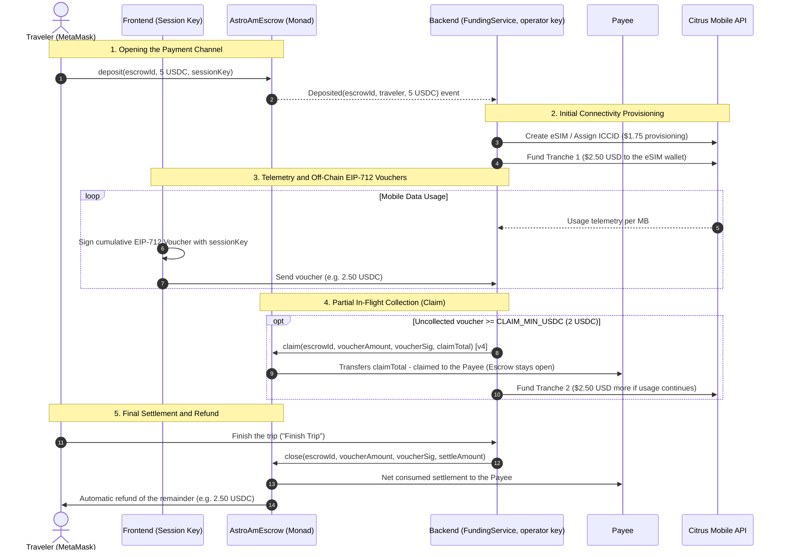

# Fund Flow Architecture on Monad

**Project:** AstroAm · **Ecosystem:** Monad Testnet (Chain ID 10143)  
**Date formalized:** 2026-10-07 · **Milestone:** Metropolis Delivery Milestone (2026-10-13)  
**Deployed contract:** `AstroAmEscrow.sol` v3 (`0xe89893d51180e517e2bf175398aad2e6da82c0f9`). v4 is implemented and tested, but **not deployed**: see the next section.

---

## Update for escrow v4 (2026-10-13)

This update supersedes the parts of the text below that describe v3.
Where the two differ, this section wins. The rest of the document (the tranche
policy to Citrus, the vouchers, the decisions D-1 to D-3) still applies,
except where marked.

**Status.** v4 is implemented and tested (`contracts/`, `src/rails/`) and is
**not deployed**. The deployed escrow is still v3 at
`0xe89893d51180e517e2bf175398aad2e6da82c0f9`, and the only end-to-end testnet
run is the 2026-10-07 one on v3 ([report](../monad-e2e-test-report.md)). The
v4 address will be recorded in [monad-deployments.md](../monad-deployments.md)
after the team deploys it.

**Operator and payee are two accounts.**

- The `payee` is fixed at deployment and receives every `claim` and `close`
  payment. It can be a cold wallet or a multisig (a plan, not done), and it is
  the only account that can call `setOperator`.
- The `operator` is the server's hot key (`MONAD_OPERATOR_PRIVATE_KEY`). It
  sends `claim` and `close` and never receives funds. The payee may send them
  too. Anyone else reverts with `NotOperator`.
- In v3 one account was both, and a job swept the collected USDC to a
  treasury. **The treasury sweep no longer exists** in v4: the rail, the
  fund-flow job and the configuration lost it. `TREASURY_ADDRESS`,
  `BRIDGE_LIQUIDATION_ADDRESS` and `TREASURY_SWEEP_MIN_USDC` are removed. The
  "Phase 2" in D-1 that activates `TREASURY_SWEEP_MIN_USDC` is therefore not
  a switch to flip: it would be new work. Converting the collected USDC to
  dollars stays a manual step by whoever controls the payee.

**`claim` collects what was used.** The signature is
`claim(escrowId, voucherAmount, signature, claimTotal)`. The app signs vouchers
ahead of usage, so a voucher is a ceiling, not a bill. `claimTotal` is the
running total the payee will have been paid after the call: above what was
already claimed (`NothingToClaim`) and never above the voucher
(`ClaimExceedsVoucher`). The backend claims `min(used, voucher)`, so what is
claimed never exceeds what was used, and `close` at the used amount is never
below the claimed total. The sequence diagram below shows the v3 call
(`claim(escrowId, 2.50 USDC, voucherSig)` paying the whole voucher); in v4 the
amount paid is `claimTotal - claimed`.

**What stays trusted.** The contract cannot know the usage, so the voucher is
the only bound it enforces on whoever operates the channel. The usage figures
come from AstroAm's metering and the provider's reports. See the trust model in
the [README](../../README.md#trust-model).

**Mission log.** Spec 06 adds an append-only log per mission
(`DATA_DIR/mission-log.jsonl`, `GET /api/missions/:id/logs`) of the eSIM, the
usage, the vouchers and the escrow transactions. It records amounts and
transaction hashes, never a key, a voucher signature or the eSIM activation
code. Its event list is in [specs/06-mission-log.md](../specs/06-mission-log.md).

**Citrus reseller balance and auto-refill** (note carried over from
astroam-solana's `docs/decisions/fund-flow-architecture.md`, 2026-10-07; it is
about Citrus, not about a chain, and was read there on 2026-10-05):

- The reseller balance is one pot in dollars for the whole account. $1.75 comes
  out of it each time an eSIM is created (that is spend). What is passed to an
  eSIM (`POST /esim/{iccid}/fund`) moves to that eSIM's own wallet (a transfer,
  not spend), and `POST /esim/{iccid}/defund` returns what the eSIM did not use.
- There is no API to load the reseller balance. It is loaded from the Citrus
  dashboard with a card, minimum $10.
- Auto-refill (set in the dashboard: "when the balance drops below $X, charge
  $Y") fires once per crossing of the threshold, and **only real spend
  triggers it**. For AstroAm the only real spend is creating an eSIM. Tranches
  to an eSIM never charge the card. If the charge fails (card declined, 3DS)
  auto-refill turns itself off until someone turns it on again, after a manual
  top-up.
- Not confirmed there: what happens when tranches leave the balance below the
  threshold without triggering anything and an eSIM is created afterwards.
  `docs/citrus-auto-refill-testing.md` is the plan for that test.
- Consequence: keep a high threshold (the Solana note suggests $50 with a
  $100 charge) and watch the balance. The backend does this with
  `CITRUS_RESELLER_LOW_BALANCE_USD` (default 20).

The sections below keep their v3 text. In section 3.1 read `claim` as the v4
signature above, and `claim`/`close` as callable by the operator or the payee.

---

## 1. Executive Summary

AstroAm provides international mobile connectivity (eSIM) paid per megabyte consumed in USDC, guaranteeing the immediate return of the unused deposit when the trip ends.

This document sets out the overall architecture of AstroAm's fund flow on **Monad**, describing the interaction between the on-chain payment channels (EVM), the issuance of off-chain cryptographic vouchers (EIP-712), the staged provisioning of telecom balance with Citrus Mobile, and the technical resolution of the strategic decisions on offramp (D-1), delivery scope (D-2) and treasury/yield management (D-3).

---

## 2. General Fund Flow Diagram



---

## 3. System Components

### 3.1. Escrow on Monad (`AstroAmEscrow.sol`, described for v3; see the v4 update above)

The smart contract acts as a decentralized, immutable fiduciary custodian on the Monad Testnet network:

- **Network:** Monad Testnet (Chain ID `10143`), benefiting from Monad's parallel execution and sub-second finality.
- **Native payment token:** Circle USDC (`0x534b2f3A21130d7a60830c2Df862319e593943A3`, 6 atomic decimals).
- **Deployed address (v3):** `0xe89893d51180e517e2bf175398aad2e6da82c0f9` ([View on MonadVision](https://testnet.monadvision.com/address/0xe89893d51180e517e2bf175398aad2e6da82c0f9)).
- **Official payee:** `0xE3E38BE1522E2086B135cb9e9b3D223708485316` (AstroAm operator's institutional wallet).
- **Key mechanisms:**
  1. `deposit(bytes32 escrowId, uint256 amount, address signer)`: Locks the traveler's USDC and explicitly authorizes the session key (`sessionKey`) that will sign the off-chain vouchers.
  2. `topUp(bytes32 escrowId, uint256 amount)`: Allows increasing the available budget in the same channel without restarting the session or the eSIM.
  3. `claim(bytes32 escrowId, uint256 voucherAmount, bytes signature)`: Allows the payee (in v3) to withdraw accumulated funds already covered by a signed voucher without closing the channel (`voucherAmount - claimed`).
  4. `close(bytes32 escrowId, uint256 voucherAmount, bytes signature, uint256 settleAmount)`: Settles the actual final usage (`settleAmount`), transfers the pending difference to the payee and immediately and unconditionally refunds the remaining balance (`deposit - settleAmount`) to the traveler's wallet.
  5. `refund(bytes32 escrowId)`: "Dead-man switch" safety mechanism. If 30 days (`MONAD_TIMEOUT_SECONDS = 2592000`) pass since the last activity without the operator having closed the channel, the traveler (or any third party) can claim the return of 100% of the unclaimed funds (`deposit - claimed`).

### 3.2. EIP-712 Off-Chain Vouchers and Session Keys

To remove the friction of requiring MetaMask approvals for every megabyte of data, AstroAm uses cumulative off-chain vouchers:

- **Standard:** EIP-712 (Typed Structured Data).
- **Domain structure:**
  - `name`: `"AstroAmEscrow"`
  - `version`: `"1"`
  - `chainId`: `10143`
  - `verifyingContract`: `0xe89893d51180e517e2bf175398aad2e6da82c0f9`
- **Signed message:** `Voucher(bytes32 escrowId, uint256 cumulativeAmount)`.
- **Session key management:**
  - The frontend generates a local ephemeral key pair (`secp256k1`) when the trip starts.
  - The private key is kept exclusively in the browser (`localStorage`).
  - The public key is sent in the `deposit` transaction.
  - The backend cryptographically validates each voucher with `ecrecover`, verifying that the signer matches the `sessionKey` or the traveler's wallet (`travelerAddress`).
- **Authorization buffer:**
  - As the device consumes data, the frontend signs cumulative vouchers slightly above strict consumption to ensure network continuity without latency.
  - In case of premature closure or interruption, the contract protects the traveler: the operator can **never** settle above the last signed voucher, and the remaining refund is automatic.

### 3.3. Tranches to Citrus Mobile (`FundingService`)

Citrus Mobile operates on a prepaid model: each eSIM has a virtual wallet that must be funded in USD before the local mobile operators route data packets.

- **Staged funding (Tranches):**
  - To minimize AstroAm's capital risk, the traveler's entire deposit is not transferred to Citrus immediately.
  - A tranche policy is used, configured in:
    - `FUNDING_TRANCHE_CENTS = 250` ($2.50 USD per tranche).
    - `FUNDING_MIN_CENTS = 50` ($0.50 USD minimum threshold to execute a top-up).
- **Pure funding rule (`nextFundCents`):**
  ```typescript
  nextFundCents = min(
    FUNDING_TRANCHE_CENTS,
    max(0, coveredVouchersUSD + FUNDING_TRANCHE_CENTS - alreadyFundedUSD),
    remainingDepositUSD
  )
  ```
- **Maximum loss limit (Worst-case loss):**
  - If a traveler closes the app, clears their browser or refuses to sign vouchers after consuming their first package, the maximum loss assumed by the operator is strictly bounded to **one tranche ($2.50 USD)**, instead of the whole deposit (e.g. $10 or $20 USD).
- **Citrus Reseller Balance Monitoring (C1-C3):**
  - The backend periodically checks the reseller account balance (`CITRUS_RESELLER_LOW_BALANCE_USD = 20`).
  - If the available balance does not cover the eSIM provisioning cost ($1.75 USD) plus the first funding tranche ($2.50 USD), the backend stops the creation of new missions, informing the user and alerting operations to avoid connectivity failures at the destination.

### 3.4. Settlement and Refund at Close

The cycle concludes through two complementary mechanisms:

1. **Active Close by the Operator (`close`):**
   - Triggered when the traveler presses "Finish Trip" or when the reconciliation job detects that the deposit has been exhausted or the grace window has expired (`ESCROW_TRIP_END_GRACE_SECONDS = 86400`).
   - The backend takes the final real consumption reading (`consumedUsdc`) and the last cumulative signed voucher (`voucherAmount`), and sends the `close` transaction.
   - The contract transfers `settleAmount - claimed` to the operator's payee account and transfers `deposit - settleAmount` directly to the traveler.
2. **Timeout Refund (`refund`):**
   - Decentralized guarantee of no permanent custody. If the backend suffered a catastrophic outage, the contract allows anyone to execute `refund(escrowId)` 30 days after the last activity (`lastActivityAt`), returning all remaining funds to the traveler.

---

## 4. Formal Resolution of Decisions (D-1, D-2, D-3)

### Decision D-1: Offramp Strategy (USDC to Fiat USD)

* **Problem:** In the parallel Solana implementation, Bridge.xyz (`BridgeClient`) was considered for direct conversion of USDC to ACH/SEPA bank accounts linked to the corporate debit/credit cards that fund Citrus. On Monad Testnet, Bridge and Circle Mint do not offer direct native support for automated fiat transfers.
* **Official Resolution:** Two-phase strategy (Hybrid → Automated):
  1. **Phase 1: Pilot and Metropolis Launch (Current):**
     - The `AstroAmEscrow` contract accumulates the net USDC generated by the collections (`claim` and `close`) in the operator's payee wallet (`0xE3E38BE1522E2086B135cb9e9b3D223708485316`).
     - To replenish fiat on the Citrus credit cards, the operator makes periodic cross-chain swaps to Bridge-compatible EVM networks (e.g. Base or Arbitrum) or liquidates through a regulated centralized exchange (CEX).
     - This approach decouples the traveler's experience (which is 100% instant and in USDC) from traditional banking rails.
  2. **Phase 2: Mainnet Roadmap (Post-Hackathon):**
     - (v4 note: this module, `TREASURY_SWEEP_MIN_USDC`, was removed; it would be new work.) Activate an automatic treasury module by connecting the deposits directly with Bridge.xyz or Circle Mint as soon as they deploy their official contracts and fiduciary rails on Monad Mainnet.

### Decision D-2: Closed Scope for the Metropolis Delivery (2026-10-13)

* **Problem:** Define exactly which components are part of the final operational delivery for the hackathon vs. deferred features.
* **Official Resolution:** Closed and completed scope:
  - **Components in Production / Verified:**
    - `AstroAmEscrow.sol` v3 contract deployed on Monad Testnet (`0xe89893d51180e517e2bf175398aad2e6da82c0f9`), with support for `deposit`, `topUp`, `claim`, `close`, `refund` and EIP-712 compatibility.
    - TypeScript backend orchestrator with `MonadRail`, network telemetry, staged tranche funding (`FUNDING_TRANCHE_CENTS = 250`), automatic periodic `claim` (`CLAIM_MIN_USDC = 2`) and auto-close on timeout/exhaustion.
    - Reseller balance gating on Citrus (`CITRUS_RESELLER_LOW_BALANCE_USD = 20`) and webhook processing.
    - Web3 frontend with destination selector, USDC budgets, native MetaMask connection, secure ephemeral session storage, silent signing and explicit warnings on mobile devices.
    - End-to-End test verified on-chain on Monad Testnet.
  - **Components Deferred to the Post-Metropolis Roadmap:**
    - Automated bank sweep (`B6`): subject to the availability of a native offramp on Monad per D-1.
    - Top-up of the Citrus reseller account through a bank transfer scheduled via API (subject to a response from the Citrus support team).

### Decision D-3: Yield Policy

* **Problem:** On networks such as Solana, integrating Kamino Finance to generate interest on the traveler's deposit during long trips was evaluated.
* **Official Resolution: Total exclusion of yield protocols on Monad for the current version.**
  - **Security rationale:** On Monad Testnet the lending and yield protocols (lending markets) are in early, unaudited testing phases. Incorporating an external yield protocol into the escrow's custody flow would introduce liquidation risk, oracle risk and smart contract risk that are unnecessary for a product focused on payments and connectivity.
  - **User experience:** The critical priority for the traveler is absolute certainty that their unconsumed refund is available instantly when pressing "Finish Trip". Locking funds in yield protocols with possible deleveraging delays would affect the immediacy of the refund.
  - **Mainnet roadmap:** When consolidated protocols (such as Aave v3 or Morpho Blue) are formally deployed and audited on Monad Mainnet, an optional treasury strategy (`YieldStrategy`) will be evaluated for idle balances that exceed an established time threshold.

---

## 5. Summary of Operating Parameters

| Parameter | Environment Variable | Default Value | Purpose |
|---|---|---|---|
| Network / Chain ID | `MONAD_CHAIN_ID` | `10143` | Monad Testnet |
| Escrow Contract | `MONAD_ESCROW_ADDRESS` | `0xe89893d51180e517e2bf175398aad2e6da82c0f9` | Address of the deployed v3; v4 is pending deployment |
| Payment Token | `MONAD_USDC_ADDRESS` | `0x534b2f3A21130d7a60830c2Df862319e593943A3` | Circle USDC (6 decimals) |
| Refund Timeout | `MONAD_TIMEOUT_SECONDS` | `2592000` (30 days) | Dead-man inactivity window |
| Tranche Size | `FUNDING_TRANCHE_CENTS` | `250` ($2.50 USD) | Limit per eSIM top-up |
| Tranche Minimum Threshold | `FUNDING_MIN_CENTS` | `50` ($0.50 USD) | Minimum gap to top up |
| Claim Minimum Threshold | `CLAIM_MIN_USDC` | `2` (2 USDC) | In-flight on-chain collection |
| Auto-close Margin | `ESCROW_CLOSE_MARGIN_SECONDS` | `86400` (24 hours) | Preventive close before timeout |
| Trip End Grace | `ESCROW_TRIP_END_GRACE_SECONDS`| `86400` (24 hours) | Close after the agreed date |
| Citrus Balance Alert | `CITRUS_RESELLER_LOW_BALANCE_USD`| `20` ($20 USD) | Preventive reseller threshold |
| eSIM Provisioning Cost | `CITRUS_ESIM_PROVISION_CENTS`| `175` ($1.75 USD) | Minimum reserve per eSIM |
